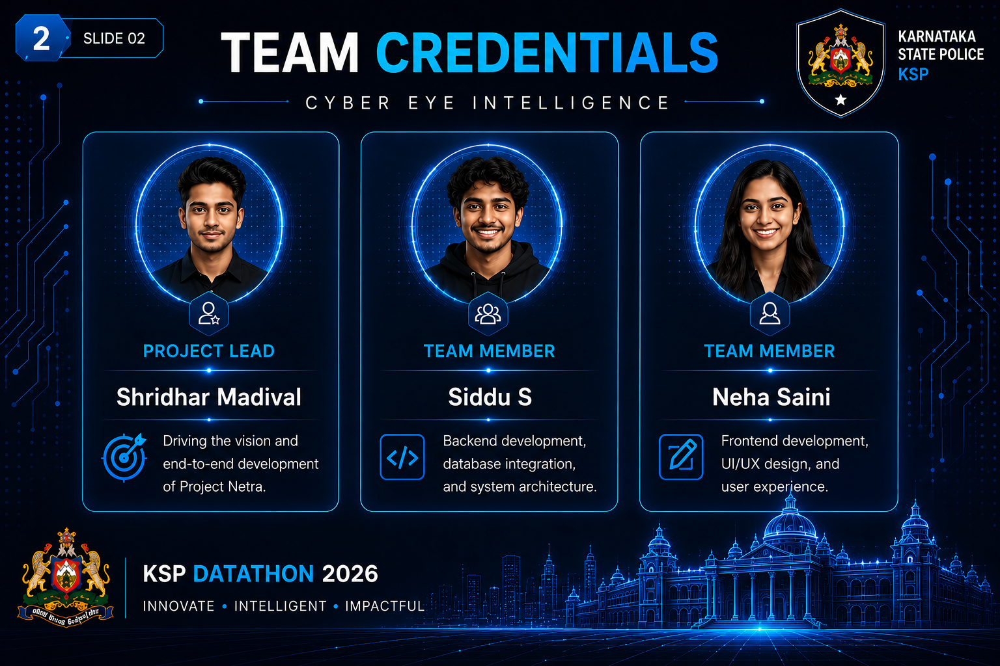

# Project Netra — Cyber Eye

**AI-assisted crime data intelligence for Karnataka State Police.**
Built for the **KSP Datathon 2026** by **Team Cyber Eye**.

A prototype that turns FIR records into searchable, connected intelligence: query the dataset in plain language,
surface patterns across districts and crime categories, and get AI-assisted briefings instead of raw tables.

> **Data disclaimer:** the dataset in this repository (`karnataka_police_fir.db`) is **fully synthetic** — generated
> for the datathon. It contains no real police records, no real complainants, and no real case data.
> This is an independent team submission and is **not** an official Karnataka State Police product.

---

## What it does

| | |
|---|---|
| **Search & retrieve** | Query FIR records by district, category, date range or free text — in seconds, not file-by-file. |
| **Pattern surfacing** | Aggregate across thousands of records to find clusters and trends: rising categories, standout districts and stations. |
| **AI-assisted briefing** | An agent layer turns retrieved records into a written summary — a starting point for a human, never a replacement. |

---

## Architecture

```
┌─────────────────┐      ┌──────────────────────┐      ┌────────────────────┐      ┌──────────────┐
│  Web client     │ ───► │  netra_backend       │ ───► │  FIR dataset       │ ───► │  Agent VEDA  │
│  HTML / JS      │      │  Catalyst function   │      │  SQLite (synthetic)│      │  analysis    │
└─────────────────┘      └──────────────────────┘      └────────────────────┘      └──────────────┘
     Catalyst-hosted          serverless                  56 MB local data          LLM-assisted
```

The client never touches the database directly — all data access goes through the `netra_backend` function.

---

## Repository layout

| Path | What's in it |
|---|---|
| `KSP_Official_Build/` | **The final Catalyst project.** Deploy from here — it contains `catalyst.json`. |
| `KSP_Official_Build/client/` | Front end: `index.html`, `client-package.json`. |
| `KSP_Official_Build/functions/netra_backend/` | Serverless backend: entry point, Catalyst config, dependencies. |
| `karnataka_police_fir.db` | Synthetic FIR dataset (SQLite, 56 MB). |
| `synthetic_data/` | Generators and intermediate data used to build the dataset. |
| `schema.pdf` | Data model and field documentation. |
| `archive/` | Earlier builds — Agent VEDA, the first datathon attempt, working drafts. Kept for history. |
| `docs/` | Source for the GitHub Pages showcase site. |

---

## Screenshots

<p align="center">
  
</p>

<p align="center">
  
  
</p>

---

## Running it locally

**Requirements:** Node.js and the Zoho Catalyst CLI.

```bash
# 1. Clone
git clone https://github.com/shridhar-1/Project-Netra.git
cd Project-Netra/KSP_Official_Build     # catalyst.json lives here

# 2. Install backend dependencies
cd functions/netra_backend
npm install
cd ../..

# 3. Bind this folder to your own Catalyst project
catalyst login

# 4. Run
catalyst serve          # local
catalyst deploy         # to your Catalyst environment
```

Install the CLI first if you don't have it: `npm i -g zcatalyst-cli`

> `.catalystrc` is deliberately **not** committed — it holds your personal project binding and would only conflict
> across machines. `catalyst login` regenerates it.

---

## Tech stack

`Zoho Catalyst` · `Catalyst Functions` · `Node.js` · `JavaScript` · `Python` · `SQLite` · `AI agents / LLM` · `HTML/CSS`

Zoho Catalyst was chosen so a small team could ship a data-heavy app without provisioning or managing servers.

---

## Live demo

The live application runs on a Catalyst deployment and requires its serverless backend, so it can't be reproduced on
static hosting.

The **[showcase site](https://shridhar-1.github.io/Project-Netra/)** on GitHub Pages describes the project, the
architecture, and how to run it yourself.

---

## Team

**Team Cyber Eye** — KSP Datathon 2026

---

## License

Released for portfolio and reference use. If you intend to reuse significant portions, open an issue first.
